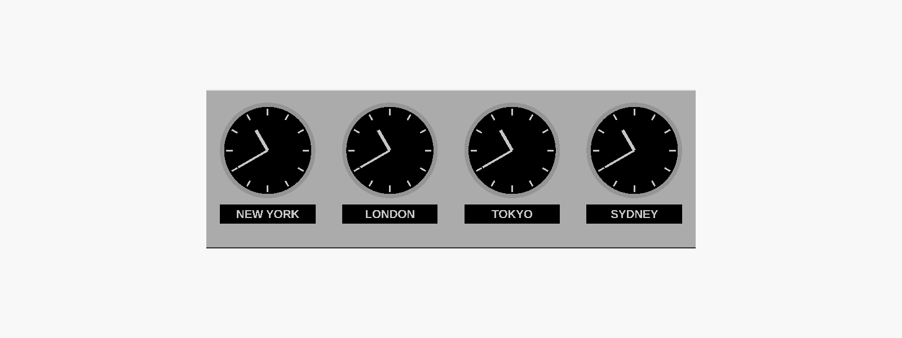

# Porta orologi "World Time" (stile Wall Street)

Supporto da parete stampabile in 3D per più orologi affiancati, ognuno con la
targhetta della città. Gli orologi **non** sono inclusi: il modello è fatto per
**inserti al quarzo da 90 mm** (foro di montaggio **78 mm**, profondità del
corpo circa 15 mm), che si comprano online a pochi euro l'uno.



## File

| File | Cosa contiene |
|---|---|
| `porta_orologi.scad` | Modello parametrico OpenSCAD: modifica qui misure, numero di orologi, città |
| `stl/modulo_orologio.stl` | Un modulo = un orologio. Stampane uno per ogni orologio |
| `stl/targhetta_*.stl` | Targhette con il nome della città (base nera + scritta in rilievo) |
| `anteprima_retro.png` | Vista posteriore del modulo (manicotto, viti, asole per appendere) |

## Misure

- Modulo: **115 × 150 × 25 mm**, entra in qualsiasi piatto da 220 × 220 mm
- 4 moduli affiancati = **460 × 150 mm**
- Foro orologio: 78,4 mm (78 + 0,4 di tolleranza), con manicotto posteriore che tiene dritto l'inserto
- Targhetta: 90 × 18 mm, si incastra in una sede profonda 1,6 mm sul fronte

## Stampa

- **Modulo**: col fronte appoggiato al piatto (come esce dall'STL). Nessun supporto.
  PLA o PETG, layer 0,2 mm, 3 perimetri, infill 15–20 %.
- **Targhetta**: piatta sul piatto. Per la scritta bianca su fondo nero metti un
  cambio filamento (pausa) all'altezza **2,4 mm**.

## Montaggio

1. **Unire i moduli**: due viti **M3 × 20** con dado per ogni giunzione. Il dado
   va nella sede esagonale all'interno di un modulo, la vite entra dal modulo
   accanto.
2. **Targhette**: incastrale nella sede e fissale con una goccia di colla (cianoacrilica o vinilica).
3. **Orologi**: inserisci gli inserti dal davanti. Se ballano, una striscia di
   nastro biadesivo o di carta attorno al corpo; se sono troppo stretti alza
   `gioco_foro` nel file `.scad`.
4. **A parete**: ogni modulo ha due asole a buco di serratura in alto. Bastano
   le due esterne (primo e ultimo modulo), con viti a testa tonda Ø testa ≤ 9 mm,
   gambo ≤ 4,5 mm. Mettile in bolla a 460 − 28 = **432 mm** di distanza (con 4 moduli).

## Personalizzare

Apri `porta_orologi.scad` in [OpenSCAD](https://openscad.org) (gratuito) e cambia i parametri:

- inserti di misura diversa → `foro_orologio`, `diam_cornice`, `prof_corpo`
- spaziatura → `larghezza`, `altezza`
- nuova targhetta da riga di comando:

```sh
openscad -D 'part="targhetta"' -D 'citta="MILANO"' -o milano.stl porta_orologi.scad
```

**Prima di stampare, misura il foro indicato nella scheda dell'inserto che compri** e, se non è 78 mm, aggiorna `foro_orologio`.
